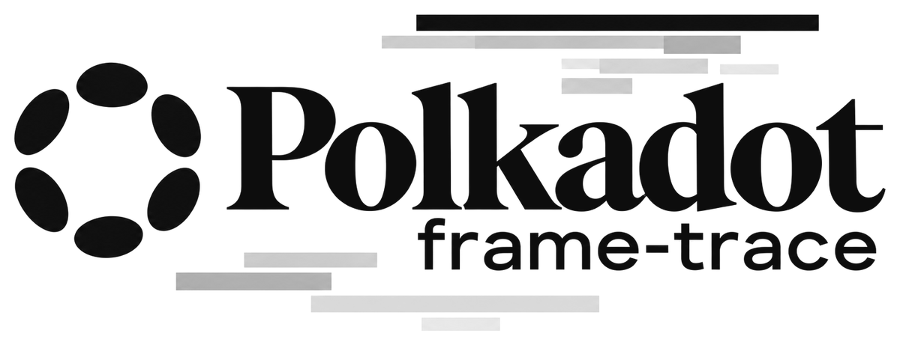

<p align="center">
  <picture>
    <source media="(prefers-color-scheme: dark)" srcset="https://raw.githubusercontent.com/agustinustheo/polkadot-frame-trace/main/docs/images/logo-dark.png">
    
  </picture>
</p>

<p align="center">
  <b>Replay any Polkadot SDK block on your machine and see every storage read and write as a trace.</b>
</p>

<p align="center">
  <a href="https://github.com/agustinustheo/polkadot-frame-trace/actions/workflows/ci.yml?query=branch%3Amain"></a>
  <a href="https://github.com/agustinustheo/polkadot-frame-trace/actions/workflows/nightly.yml"></a>
  <a href="https://github.com/agustinustheo/polkadot-frame-trace/releases/latest"></a>
  <a href="https://github.com/agustinustheo/polkadot-frame-trace/blob/main/LICENSE"></a>
  <a href="https://github.com/agustinustheo/polkadot-frame-trace/releases"></a>
  <br>
  
  
  
  
  
  <br>
  <a href="https://github.com/agustinustheo/polkadot-frame-trace"></a>
  <a href="https://github.com/agustinustheo/polkadot-frame-trace/graphs/contributors"></a>
  <a href="https://github.com/agustinustheo/polkadot-frame-trace/commits/main"></a>
</p>

---

`polkadot-frame-trace` replays a block on your machine with the chain's own runtime, using state from any node's normal RPC.
It records every storage read and write and checks that the replay reached the block's state root.
It exports the result as an OpenTelemetry trace for Jaeger or Grafana Tempo, or as JSON.

It is for runtime and pallet developers and chain teams who want to know why a block costs what it does.
Find the storage items a block reads most, the reads it repeats, and the bytes each one adds to the proof.


*Block #4 of a People chain in Jaeger. (1) The block, (2) the `Utility.batch` extrinsic and (3) the runtime calls inside it. (4) A read of Bob's account, (5) where it was answered, (6) the bytes it added to the proof and (7) its duration.*

## Start

[Install polkadot-frame-trace](https://agustinustheodorus.com/polkadot-frame-trace/getting-started/install.html), then [open your first trace in Jaeger](https://agustinustheodorus.com/polkadot-frame-trace/getting-started/first-trace.html).
[Commands and flags](https://agustinustheodorus.com/polkadot-frame-trace/reference/commands.html) lists the commands and outputs.

### A replay, as you see it

Block #4 of the local People chain is saved in this repository. From a clone, replay it with no network:

```sh
polkadot-frame-trace block --offline fixtures/replay/people-traced
```

```text
replay #4: loading runtime and preparing state
root check: PASS; RPC calls: 0 (timed replay: 0); execution proof: 6586 bytes
fetching state #4: 0 proof request rounds; 0 RPC calls
state root: computed 0x47116eac39ac59ba0534a0e4d624f78c4c8c56af5c3084e71c98ca1811e6e4f1; header 0x47116eac39ac59ba0534a0e4d624f78c4c8c56af5c3084e71c98ca1811e6e4f1
block 0x0661899538bf75f600c05c9cc31a01d34e95be6ea6096230a2af6a0074d90637 (parent 0xaa9b6d9f7f0d74a603f7d763724d812f468139427ba81f5f22dc82a7d4026de6)

Storage per phase
┌──────────────────────────────────────────────────┬────────────┬───────┬────────┬─────────────┬─────────────────┬──────────────┐
│ phase                                            ┆ operations ┆ reads ┆ writes ┆ proof bytes ┆ storage time µs ┆ wall time µs │
╞══════════════════════════════════════════════════╪════════════╪═══════╪════════╪═════════════╪═════════════════╪══════════════╡
│ initialization                                   ┆        152 ┆    74 ┆     77 ┆        3490 ┆           277.0 ┆        486.4 │
│ extrinsic 0: ParachainSystem.set_validation_data ┆         54 ┆    26 ┆     28 ┆         495 ┆           149.5 ┆        274.2 │
│ extrinsic 1: Timestamp.set                       ┆         26 ┆    14 ┆     12 ┆         139 ┆            38.3 ┆         54.4 │
│ extrinsic 2: Utility.batch                       ┆        200 ┆   146 ┆     54 ┆         827 ┆           532.2 ┆        774.0 │
│   └ post inherents (on_poll)                     ┆         14 ┆    12 ┆      2 ┆         686 ┆            32.4 ┆         38.9 │
│ finalization                                     ┆         72 ┆    40 ┆     31 ┆         949 ┆           271.7 ┆        452.1 │
│ total                                            ┆        518 ┆   312 ┆    204 ┆        6586 ┆          1301.1 ┆       4811.4 │
└──────────────────────────────────────────────────┴────────────┴───────┴────────┴─────────────┴─────────────────┴──────────────┘

1 block(s); 518 operations; reads 312 = cache 231 + trie 81 (already in proof 47, new 34) + unknown 0
Duplicate reads 203 = cache 177, trie (already in proof) 26, trie (new) 0, unknown 0; proof 6586 B (518 operations with proof data; 0 B not assigned to operations)
...
```

`root check: PASS` means the replay reached the same state root as the block header.
Times are measured on your machine, not on the node. The rest of the output ranks storage items, extrinsics and repeated reads.

[What polkadot-frame-trace supports](https://agustinustheodorus.com/polkadot-frame-trace/reference/support.html) lists the chain requirements, tested chains and RPC methods.

## Contribute

Docs follow [docs/STYLE.md](https://github.com/agustinustheo/polkadot-frame-trace/blob/main/docs/STYLE.md), and developer notes are in [`dev/`](https://github.com/agustinustheo/polkadot-frame-trace/blob/main/dev/README.md).

## License

Apache-2.0. See [LICENSE](https://github.com/agustinustheo/polkadot-frame-trace/blob/main/LICENSE).

<sub>Polkadot is a trademark of the Web3 Foundation. This project is independent and is not affiliated with or endorsed by the Web3 Foundation.</sub>
